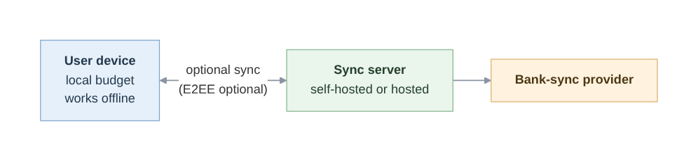
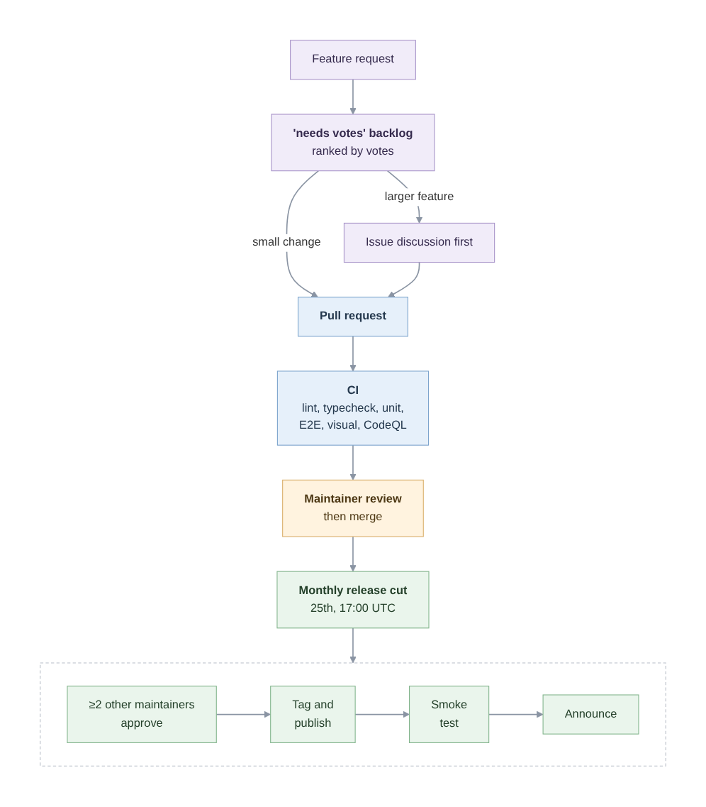
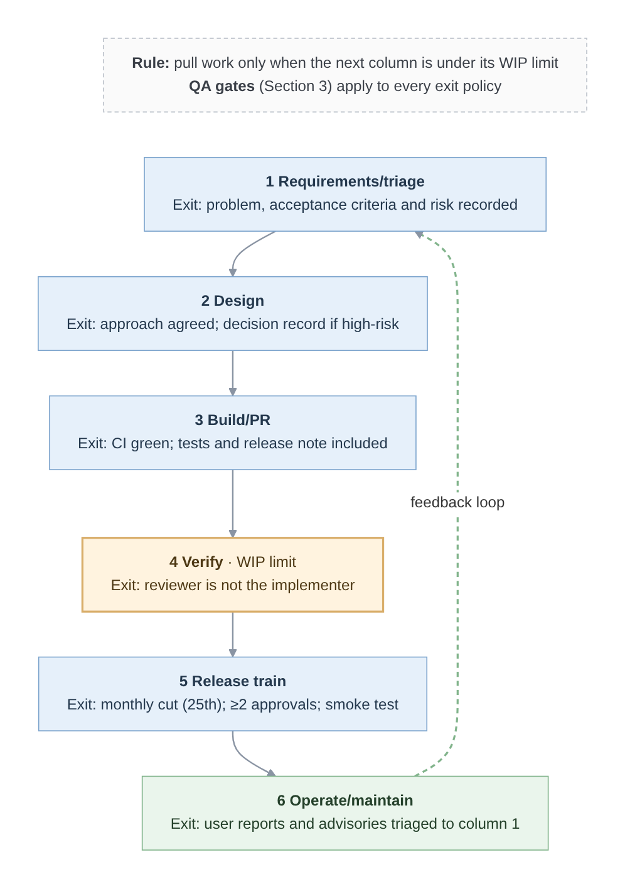

# Software Quality Engineering Evaluation of Actual Budget: Methodology, Quality Assurance and IV&V

*Working title; cover page, table of contents and lists are added at final assembly.*

# Executive Summary

This report evaluates Actual Budget, a free, open-source and local-first personal finance application run by a small volunteer team, whose users must be able to trust its numbers and the security of their data.

Actual has a defined workflow but no deliberate methodology. Its profile suits an agile approach, except that its few reviewers are overloaded and its defects can affect money and data. Out of five candidates, we chose Kanban because it limits the review backlog, and then mandatory quality gates are added because Kanban prescribes no quality practices.

Furthermore, The QA process focuses on three ISO/IEC 25010:2023 characteristics: Security, Reliability and Interaction capability. Public evidence shows no written QA plan and gaps in proactive security verification, coverage measurement and accessibility testing. The plan also adopts OWASP ASVS 5.0.0 and WCAG 2.2 and writes risk-scaled checks into the exit policy of each Kanban column.

Lastly, IV&V adds risk-tiered independent review inside the team, plus external checks through coordinated disclosure and an optional funded audit. The outside checks are kept because all three 2026 security flaws were found by reporters outside the team, after release.

# 1 Introduction

## 1.1 Background and Purpose

Personal finance applications help people record spending and plan a budget. Because they hold balances, transactions and sometimes bank connections, their quality matters. A wrong total can lead to a poor financial decision, while a security flaw can expose private data.

I chose Actual Budget because I was looking for an open-source personal finance application that I could self-host on an old laptop at home to manage and keep track of my finances. And this assignment allowed me to examine it in depth.

This report covers three topics. Section 2 selects a software development methodology for the project, Section 3 sets out a quality assurance (QA) process, and Section 4 integrates independent verification and validation (IV&V) into the selected methodology.

## 1.2 What Is Actual Budget

Actual Budget ("Actual") is a free, open-source personal finance application released under the MIT licence. Its focus is mainly on local-first, and the budget is kept on the user's own device, while syncing between devices is optional (Actual Budget, 2026a). It targets privacy-minded budgeters, self-hosters and families. Furthermore, the project defines success as users trusting its numbers (Actual Budget, 2026a). By default, Actual uses envelope budgeting, in which people budget the money they already have, rather than the income they expect to receive (Actual Budget, n.d.-j).

Actual was created by James Long, who ran it as a paid product for over four years (Stacoviak & Santo, 2022). In early 2022 he decided to close the commercial product and released it as open source, and it is now maintained by volunteers, which led by a core team that formed after pull requests had waited months for review (Aboltins, 2025).

## 1.3 Main Features and How It Works

Actual covers budgeting, accounts and transactions, rules, scheduled transactions and reports (Actual Budget, n.d.-j). It runs as a desktop app, through Docker or on paid hosting from PikaPods or Fly.io (Actual Budget, n.d.-c).

Basic budgeting does not require a server, but syncing between devices and bank synchronisation both will need one (Actual Budget, n.d.-c). Users can enable end-to-end encryption for synced data, but it does not protect data stored on the local device or the bank-sync tokens held on the server (Actual Budget, n.d.-h). Figure 1 shows how the parts connect.

*Figure 1. How Actual Budget works (based on Actual Budget, n.d.-c).*

## 1.4 Who Is Involved

*Table 1.1. Main stakeholders of Actual Budget.*

| Stakeholder | Role and interest |
|---|---|
| Users | Need correct figures and private data |
| Self-hosters | Run their own server and need it secure |
| Core maintainers | Eight listed maintainers who review and release (Actual Budget, n.d.-a) |
| Contributors | Volunteers who choose their own work (Actual Budget, n.d.-a) |
| Donors and hosting partners | Fund the project through Open Collective (Actual Budget, n.d.-e); PikaPods reported over 8,000 users in December 2025 (youngcw, 2025) |

## 1.5 Main Challenges

- **Volunteer capacity and changing requirements.** Work depends on volunteers, and review has been a bottleneck before (Aboltins, 2025).
- **Trust in the numbers and data security.** Users rely on correct figures and protected data.
- **Escaped defects and security flaws.** Problems found after release harm users.

<!-- Cited: S01, S02, S08, S10, S11, S15, S51, S121, S122 -->

# 2 Software Development Methodology

Because a methodology can only be judged against the project it must serve, this section first describes how Actual works today. It then explains why Kanban, tailored with quality gates, fits Actual better than Spiral, Scrum, Extreme Programming (XP) or DevOps, and then shows how it would work in practice and examines its weaknesses.

## 2.1 Current Development Process of Actual

Actual's contributor documentation does not name any methodology (no evidence found, October 2026). However, it does describe the same workflow for every change, shown in Figure 2.

Users' feature requests are ranked by votes, and nobody is assigned to those requests by force. Contributors can choose which to work on and submit a pull request (PR). Continuous integration (CI) and a core maintainer will then check the PR, and a monthly release train ships whatever is ready (Actual Budget, 2026a, n.d.-a, n.d.-b, n.d.-d).

The step that has caused trouble is review. Because only maintainers can approve a PR, and the project lists eight of them as of October 2026 (Actual Budget, n.d.-a). After Actual became open source in 2022, there were PRs that have been waited months because nobody was available to review them (Aboltins, 2025). The project now starts to pay maintainers for review and triage from a 2,000 USD monthly pool funded by donations (Actual Budget, n.d.-e). This shows that the review time is its scarcest resource.

Therefore, Actual has a defined workflow, but no deliberate methodology. The steps are clear, but nothing manages how work moves through them, and nothing limits how many PRs can pile up waiting for the few people that are able to review them.

*Figure 2. Actual's as-is development workflow (compiled from the sources cited in 2.1).*

## 2.2 Why Kanban Fits Actual

A software process model is commonly chosen by weighing eight factors about the project, such as project requirements, risk tolerance, team expertise and more. For Actual, most of these factors point to an agile model rather than a linear one such as Waterfall, as the project's requirements change continuously as users vote. Users are also closely involved because their votes shape the work, and each monthly release ships whatever is ready rather than a fixed plan. However, there are two factors that weaken the case, because agile methods rely on an experienced team and low risk tolerance favours linear models. On team expertise, the few experienced reviewers are volunteers whose time has already run out once (Aboltins, 2025). On risk tolerance, Actual cannot accept much risk, because a wrong balance could lead a household to a poor spending decision, and a security flaw can expose private financial data. There was already a case where a critical flaw that allow anyone read an users' bank balances and transactions without the need to log in at all (Actual Budget, 2026c).

From this profile, the methodology has to meet five needs: handle changing priorities, work with tasks that volunteers choose themselves, keep its rules written down, protect review time, and also include quality and risk controls.

Kanban meets the first four needs. It protects review time by limiting work in progress (WIP), the number of items allowed in a stage at once (Kanban University, n.d.). This assignment proposes placing that limit on review. Once it is reached, no new PRs enter review until waiting ones are cleared. Kanban also keeps its rules written down, because the conditions for moving work between stages are explicit and do not depend on who happens to be on the team. It also handles changing priorities and self-chosen tasks, because contributors still pull work from the voted backlog whenever they have time, and nobody has to commit to a fixed amount of work. Finally, Kanban is applied on top of an existing process without replacing it, so Actual keeps the workflow that already suits its volunteers.

However, Kanban doesn't meet the fifth need. It doesn't say how quality should be checked, and this matters because Actual's risk tolerance is low. The assignment therefore adds mandatory QA gates (defined in Section 3).

For more detail information, appendix A sets out how this choice was reached. Actual was profiled against eight standard selection factors, and Kanban was compared with Spiral, Scrum, Extreme Programming (XP) and DevOps. To briefly summarise it, Scrum and XP require team members to commit their time together, which volunteers cannot do. Spiral would place expert risk analysis on the already overloaded reviewers. And DevOps mainly adds automated testing, which Actual's CI already provides.

## 2.3 Applying Kanban to Actual

Figure 3 shows the proposed board. Each piece of work, such as a bug fix or a new feature, is a card that moves through six columns in order, from triage to operation. Each column has an exit policy, which is a written condition that must be met before work can be pulled into the next column (Ahmad et al., 2018, p. 98).

The WIP limit proposed in Section 2.2 sits on the Verify column, where review happens. It should be set from the number of reviews the maintainers actually complete, so that new work stops entering once reviews start to pile up.

*Figure 3. Proposed (to-be) Kanban workflow for Actual with explicit exit policies.*

## 2.4 Critical Evaluation

Kanban manages flow but does not improve quality by itself. It is "a relatively basic flow tool that needs to be supported by additional practices" (Ahmad et al., 2018, p. 110), which is why the QA gates in section 3 are mandatory. Its WIP limit is also weaker in a volunteer project. It holds new PRs back and those PRs would wait like unanswered ones, which maintainers report discourages new contributors (Salkever, 2023, p. 5). However, PRs has already been waited months for review before any limit existed (Aboltins, 2025), so the limit makes the wait visible rather than creating it. Maintainers can also raise the limit at any moment if it starts to deter newcomers. The choice could also be revisited if Actual gains staff who can commit fixed hours in the future, which would make Scrum's commitments realistic, or runs its own hosted service which would give DevOps operations a chance to be implemented.

<!-- Cited: S01, S02, S03, S04, S08, S10, S26, S34, S36, S38, S47, S105, S108, S109, S121, S123, S128, S63-m2cq -->

# 3 Quality Assurance Process

This section defines what quality means for Actual and which attributes matter the most, finds the gaps in the current practice, selects standards to close them, then builds the resulting plan into the Kanban workflow and examines its weaknesses.

## 3.1 What Quality Means for Actual

Quality can be defined from five viewpoints, adapted from Garvin (1984). And each of them describes what quality means for Actual:

- User-based: 
	For users, quality means balances and envelope totals that are correct, private and easy to understand.
- Product-based: 
	Quality lies in properties of the software itself, such as access control on the sync server and the integrity of budget data.
- Process-based: 
	For Actual, quality means every change passes the same written checks, no matter who reviews it.
- Value-based: 
	Actual is free and funded by donations, so the quality work must be affordable in volunteer time.
- Transcendent:
	In terms of transcendent view, quality refer to the sense that the app can be trusted with one's money. Users recognise it through daily use, and it will also be built up when the other four views above are met.

Together, these views give Actual's QA process one aim, which is to keep users' financial data correct and private, through checks that apply to every change but cost little volunteer time.

## 3.2 Key Quality Attributes

ISO/IEC 25010:2023 defines nine product quality characteristics (International Organization for Standardization & International Electrotechnical Commission, 2023). This report focuses on three of them: Security, Reliability and Interaction capability. Each was chosen because it meets two criteria, a failure would seriously harm users, by risking their money or data or locking them out of the app, and public evidence shows that Actual's current checks leave a gap (Section 3.3).

- Security: 
	Actual stores user's transactions, balances and bank connections, which is some of the most private data a person has. If that data leaks or is changed without any permission, the users could face fraud or lose control of their finances.
- Reliability: 
	Users decide what to spend based on the balances Actual shows, so budget data must stay correct and in sync across devices, including after the app recovers from a failure. If it fails, users may stop trusting their numbers or be locked out of their own budget.
- Interaction capability: 
	Actual is used by normal people to manage their own money, so it must be usable by people with different abilities and help them understand envelope budgeting. Actual already targets WCAG 2.1 AA (Actual Budget, 2026a), so accessibility is already a stated requirement.

## 3.3 Current QA Practices and Gaps

Actual already runs substantial automated QA. Every pull request triggers linting, type checking, Vitest unit tests and a database migration check, Playwright end-to-end and visual regression tests run on pull requests or in the merge queue (Actual Budget, 2026a, n.d.-i). 

It also uses a semantic code analysis engine (CodeQL) to scan every pull requests and pushes (Actual Budget, 2026a). Moreover, releases will need approval from at least two other maintainers and do smoke tests (Actual Budget, n.d.-b). Actual's own security policy also asks for private vulnerability reporting and coordinated disclosure (Actual Budget, n.d.-g).

There are also four gaps that are discovered or happened from the research:
- Security: 
	No proactive check of access control before release. Three access-control flaws in the sync server feature were published in 2026 (Actual Budget, 2026b, 2026c, 2026d). The most critical one was about missing authentication on six of the SimpleFIN and Pluggy AI bank-sync endpoints, which the GoCardless endpoints had it (Actual Budget, 2026c). This shows inconsistent authentication across bank-sync providers, and the flaw was only found after release. The security policy also states no response time for reports (Actual Budget, n.d.-g).
- Reliability: 
	There is no test coverage measurement. Test coverage would not prove that the code is correct, but it would at least show what is untested. And reliability defects still reach users, like a sync defect that stopped some budgets from opening and it's stayed in released versions for years (Brown, 2026). Although Actual's testing checklist asks for "appropriate test coverage" (Actual Budget, n.d.-i, Testing Checklist section), there's no coverage report found in the repository, and sync-server tests have coverage switched off (Actual Budget, 2026a). Therefore, nobody can tell how much of the sync and migration code is actually tested and actually safe.
- Interaction capability: 
	No automated accessibility testing was found, despite the WCAG target (Actual Budget, 2026a).
- Process: 
	No written QA plan. Quality rules are spread across documentation, templates and CI files, so there's no a single place that states what must be checked before work moves on.

## 3.4 Selected Standards and Practices

Table 3.1 lists the standard that closes each gap from Section 3.3. Two standard are published standards that a volunteer team can use for free, while the rest are practices proposed in this report.

*Table 3.1. How each gap is closed.*

| Gap                    | Standard or practice                 | How it is used                                                                                                                                                |
| ---------------------- | ------------------------------------ | ------------------------------------------------------------------------------------------------------------------------------------------------------------- |
| Security               | OWASP ASVS 5.0.0                     | The ASVS chapters on authentication, sessions and authorisation cover the same kinds of flaw that was found in the 2026 advisories (OWASP Foundation, 2025).  |
| Security               | Authorisation test matrix (proposed) | An automated test goes through every server endpoint and checks that each one rejects requests that lack a valid login or the right permission.               |
| Reliability            | Coverage report                      | Coverage reports are switched on in the CI, so the team can see which parts of the sync and migration code have no tests.                                     |
| Interaction capability | WCAG 2.2 AA                          | Actual's accessibility target moves from WCAG 2.1 AA to 2.2 AA, the version that W3C recommends for new accessibility work (World Wide Web Consortium, 2024). |
| Process                | Written QA plan                      | Section 3.5 will sets out this plan.                                                                                                                          |

## 3.5 Applying the QA Process within Kanban

This section turns the gaps found in Section 3.3 into the QA gates of Section 2.2, by adding them to the exit policies of the Kanban board (Section 2.3). As a result, a card can only move to the next column once its quality checks have passed.

When a change only touches wording or documents, running security and data checks on it would waste the review time that Section 2.1 already found scarce. Each card or task is therefore given a risk tier at triage stage, where it decides which QA checks the card must pass before it can move along the board. The tier is based on the most serious failure the change could cause:

- High: 
	a failure that could expose financial data or credentials, give wrong money figures or lose budget data. Such as authentication & authorisation, bank integration, budget and balance calculations or sync and encryption).
- Standard:
	a failure would be visible but recoverable without data loss. Most of the features, such as reports, rules and UI components.
- Low: 
	a failure would be cosmetic like themes, wording and documentation.

These tiers were created for this report. They borrow the one idea from IEEE 1012-2024 standard: the more serious a component's possible failure, the more verification it needs (Institute of Electrical and Electronics Engineers [IEEE], 2025).

Table 3.2 shows the resulting QA plan, it explains the checks that are added to each Kanban column's exit policy, which cards they apply to, and who is responsible for what.

*Table 3.2. QA checks added to each Kanban column.*

| Kanban column       | Checks added to the exit policy                                                                                                           | Applies to                                                        | Who                          |
| ------------------- | ----------------------------------------------------------------------------------------------------------------------------------------- | ----------------------------------------------------------------- | ---------------------------- |
| Requirements/triage | The card is given a risk tier, and acceptance criteria are written for security, data and accessibility wherever the change affects them. | All cards                                                         | Triager                      |
| Design              | The endpoints and permissions the change touches are listed, and its effect on migrations and sync is stated.                             | High tier                                                         | Implementer                  |
| Build/PR            | A coverage report is produced so untested code is visible, and any new endpoint is added to the authorisation test matrix.                | All, except the matrix is for High tier                           | Implementer                  |
| Verify              | Automated WCAG 2.2 AA checks must pass, and the selected ASVS requirements are checked against the change.                                | Cards that change the UI. And ASVS for High-tier security changes | Reviewer                     |
| Release train       | A release cannot go out while any critical or high security finding is still open.                                                        | Every release                                                     | Release maintainers          |
| Operate/maintain    | Security reports are answered. Each defect that reaches users gets a regression test, and the check that missed it is being reviewed.     | Every report                                                      | Maintainers handling reports |

## 3.6 Critical Evaluation

The plan's main cost is volunteer time. Each check added to an exit policy is more work for a small team that already has little time for review (Section 2.1). The risk tiers keep this cost under control, since only High-tier cards go through the full set of checks. However, the tiers depend on judgement at triage, and a card given too low a tier will skip checks it needed. This matters most for security and data changes, where a missed check could reach users unnoticed.

<!-- Cited: S01, S03, S08, S09, S10, S38, S43, S44, S47, S51, S53, S55, S57, S58, S59, S62, S63-m2cq, S63-prp4, S63-cq9c, S82, S85, S129, S137 -->

# 4 Integrating IV&V with Kanban

This section examines how independently Actual's work is checked today, proposes an IV&V model built into the Kanban board from Section 2 and the QA plan from Section 3, and shows how the model meets the brief's three goals, which are early defect detection, requirements compliance and overall quality.

## 4.1 Current V&V in Actual and Its Independence

IEEE 1012-2024 describes verification as checking whether the products of an activity conform to that activity's requirements, and validation as checking whether the product satisfies its intended use and user needs (IEEE, 2025). Independent V&V (IV&V) adds a condition on who does the checking, the work of each phase is checked by someone other than the person who built it. Table 4.1 applies this test to Actual's existing V&V activities, phase by phase from requirements to maintenance. *Partial* means someone other than the builder is involved but the check is limited: automated tests check only what the team chose to test, and community testing of preview builds is informal.

*Table 4.1. Independence of Actual's existing V&V activities.*

| Activity                        | Phase                   | Built by                         | Checked by                                                                         | Checker separate from builder? |
| ------------------------------- | ----------------------- | -------------------------------- | ---------------------------------------------------------------------------------- | ------------------------------ |
| Requirements and design check   | Requirements, design    | Contributor proposing the change | None found in the documentation (October 2026)                                     | —                              |
| PR review                       | Implementation          | PR author                        | Another core maintainer                                                            | Yes                            |
| CI tests and CodeQL scanning    | Implementation, testing | PR author                        | Automated checks configured by the team (Actual Budget, 2026a)                     | Partial                        |
| PR preview and nightly builds   | Testing                 | PR author                        | Any community member, voluntarily (Actual Budget, n.d.-f)                          | Partial                        |
| Release approval and smoke test | Deployment              | Maintainer cutting the release   | At least two other maintainers approve; smoke tests follow (Actual Budget, n.d.-b) | Yes                            |
| Vulnerability reports           | Maintenance             | Core team                        | Reporters outside the core team (Actual Budget, 2026b, 2026c, 2026d)               | Yes, but only after release    |
| External audit                  | Maintenance             | —                                | No public evidence found in the documentation and blog (October 2026)              | —                              |

Actual therefore has real independent checking, but it is ad hoc and starts late: nobody but the contributor checks requirements or design, and how independently a change is checked depends on who happens to review or report it, not on how risky it is. The strongest independent findings came after release: the three 2026 advisories described in Section 3.3 credit reporters outside the core team with finding the flaws in released versions (Actual Budget, 2026b, 2026c, 2026d).

## 4.2 IV&V Integration Model for Kanban

To make independent checking depend on risk rather than on who happens to review, the model makes three changes.

First, it uses the risk tiers set at triage (Section 3.5), so that only High-tier cards get an independent reviewer. Independent review of every card would overload the few reviewers that Section 2 identified as the bottleneck.

Second, High-tier changes get an *independent reviewer*: a maintainer who neither wrote the change nor is listed for that area in Actual's CODEOWNERS file (Actual Budget, 2026a). For a new bank-sync endpoint, both the implementer and the sync server's listed owner are excluded, so someone else on the team must check it. The reviewer is still a member of the same small team, which is why the third change adds checks from outside it.

Third, it adds checks from outside the team, because Actual's own record shows that outsiders find what the team's review misses: all three 2026 advisories were in released code and were found by reporters outside the core team (Section 3.3). One route already exists: outside reporters using private vulnerability reporting. The other is new: an occasional external security audit of the sync server, where those flaws were, paid for by a third party so that it costs neither volunteer review time nor Actual's donations. The Open Source Technology Improvement Fund (OSTIF) arranges such audits for open-source projects with money from outside funding bodies, and reports that over 98% of the security-relevant findings from its 2025 audits were fixed (Open Source Technology Improvement Fund, 2026).

Each check is written into the exit policy of the board column where it happens, so a High-tier card cannot move on until its independent evidence is attached. This follows Smith and Hayes (2024, Abstract), who argue that agile "has in no way diminished the need for IV&V" and that IV&V should run in phase with the development cadence. High-tier reviews also count against the Verify column's WIP limit, so if they queue up, new work stops entering and the queue is visible on the board. Independent design reviews count towards the same limit, because they draw on the same reviewers. Table 4.2 shows, for each column, who checks a High-tier card independently and what evidence they leave.

*Table 4.2. Independent checks at each board column.*

| Board column | Checks | Tools | Checker | Exit policy |
|---|---|---|---|---|
| Requirements/triage | *Validate* that acceptance criteria are testable and cover security and data needs; assign the risk tier (all cards) | Issue templates, triage labels | Triager other than the requester | Tier and testable criteria recorded |
| Design | *Verify* the design listed in Table 3.2: endpoints and permissions against ASVS, selecting the requirements that apply, and that the migration and sync impact names the balances and totals to compare at Verify | Decision record, OWASP ASVS 5.0.0 | Independent reviewer | Design accepted; ASVS requirements selected |
| Build/PR | Automated checks from Table 3.2 run on every PR (all cards) | GitHub Actions, CodeQL, Vitest | None (automated) | CI green, including the authorisation test matrix |
| Verify | *Verify* the code against the selected ASVS requirements, that every new endpoint is in the authorisation test matrix, and that each acceptance criterion has a passing test; for migration, sync or calculation changes, *verify* that balances and envelope totals on a synthetic budget match before and after; *validate* behaviour on a preview build (Standard and High) | GitHub review, preview builds, Playwright, separate test server | Independent reviewer; validator other than the implementer | Approval names the ASVS requirements and tests checked; validation evidence attached; no open critical or high findings |
| Release train | *Verify* that every High-tier card in the release met its Verify exit policy | Release checklist | One of the approving maintainers | Evidence confirmed before approval and tagging |
| Operate/maintain | Triage external reports; for each fixed advisory, add a regression test and re-check the tier of the area involved | Private vulnerability reporting, advisories | External reporters; optional funded auditor; a reviewer other than the code owner for the tier re-check | Advisory published; regression test merged; tier rule corrected if the area was under-tiered |

Standard-tier cards skip the design review and need only preview-build validation; Low-tier cards follow normal review. Preview and nightly web builds have no sync server and are not meant for real budgets (Actual Budget, n.d.-f), hence the separate test server.

## 4.3 How the Integration Meets the Three Goals

Each goal is tested below against Actual's own evidence.

For early defect detection, the model would have given the critical 2026 bank-sync flaw (Section 3.3) two independent chances to be caught before release; in practice it was found only afterwards. A card that adds bank-sync endpoints is High tier, so it meets the independent reviewer twice. The first time is at Design, before any code exists: the reviewer checks each planned endpoint against the ASVS authentication requirements, so an endpoint planned without a login check is flagged there. The second is at Verify, where the reviewer confirms that every endpoint is in the authorisation test matrix (Section 3.4). This second check matters because the matrix tests only the endpoints someone adds to it, and an implementer who forgot the login check could easily forget the test as well.

For requirements compliance, the model checks that what users asked for is what was built and tested. Actual already records most of the evidence: a feature request starts as an issue, the PR template asks for the related issue, and a release note describes the result (Actual Budget, 2026a). What it lacks is anyone checking that these pieces match, and the model adds that check at both ends of the board. At triage, someone other than the requester confirms that each acceptance criterion can be tested, so a vague criterion such as "the page should feel fast" is sent back to be made measurable. At Verify, the independent reviewer does not approve until every criterion has a passing test. A high-risk requirement therefore cannot reach a release without evidence that it was met.

The model improves overall quality by moving independent checking for the code where Actual's worst 2026 flaws were (Section 3.3) to before release, while a theme or wording change still needs only one ordinary review. Defects that still escape are put to use: the Operate/maintain column turns each one into a regression test and asks whether its area was tiered too low, so the process checks for that kind of defect next time.

<!-- Cited: S01, S03, S04, S08, S62, S63-m2cq, S63-prp4, S63-cq9c, S66, S67, S69, S72 -->

# References

Aboltins, M. J. (2025, January 2). *Roadmap for 2025*. Actual Budget. https://actualbudget.org/blog/roadmap-for-2025/

Actual Budget. (2026a). *Actual* [Computer software]. GitHub. https://github.com/actualbudget/actual

Actual Budget. (2026b, June 12). *Disabled OpenID users keep access through existing session tokens* (GHSA-cq9c-6w48-qmfg) [Security advisory]. GitHub. https://github.com/actualbudget/actual/security/advisories/GHSA-cq9c-6w48-qmfg

Actual Budget. (2026c, February 20). *Missing authentication for SimpleFIN and Pluggy AI bank sync endpoints* (GHSA-m2cq-xjgm-f668) [Security advisory]. GitHub. https://github.com/actualbudget/actual/security/advisories/GHSA-m2cq-xjgm-f668

Actual Budget. (2026d, April 23). *Privilege escalation via 'change-password' endpoint on OpenID-migrated servers* (GHSA-prp4-2f49-fcgp) [Security advisory]. GitHub. https://github.com/actualbudget/actual/security/advisories/GHSA-prp4-2f49-fcgp

Actual Budget. (n.d.-a). *Contributing to Actual Budget*. Retrieved October 22, 2026, from https://actualbudget.org/docs/contributing/

Actual Budget. (n.d.-b). *How to cut a release*. Retrieved October 22, 2026, from https://actualbudget.org/docs/contributing/releasing/

Actual Budget. (n.d.-c). *Installing Actual*. Retrieved October 22, 2026, from https://actualbudget.org/docs/install/

Actual Budget. (n.d.-d). *New core contributors guide*. Retrieved October 22, 2026, from https://actualbudget.org/docs/contributing/leadership/new-core-contributors-guide/

Actual Budget. (n.d.-e). *Paying reviewers for administrative work*. Retrieved October 22, 2026, from https://actualbudget.org/docs/contributing/leadership/paying-contributors/

Actual Budget. (n.d.-f). *Preview builds*. Retrieved October 22, 2026, from https://actualbudget.org/docs/contributing/preview-builds/

Actual Budget. (n.d.-g). *Security policy* [SECURITY.md]. GitHub. Retrieved October 22, 2026, from https://github.com/actualbudget/.github/blob/main/SECURITY.md

Actual Budget. (n.d.-h). *Syncing across devices*. Retrieved October 22, 2026, from https://actualbudget.org/docs/getting-started/sync/

Actual Budget. (n.d.-i). *Testing*. Retrieved October 22, 2026, from https://actualbudget.org/docs/contributing/testing/

Actual Budget. (n.d.-j). *A tour of Actual*. Retrieved October 22, 2026, from https://actualbudget.org/docs/tour/

Ahmad, M. O., Dennehy, D., Conboy, K., & Oivo, M. (2018). Kanban in software engineering: A systematic mapping study. *Journal of Systems and Software, 137*, 96–113. https://doi.org/10.1016/j.jss.2017.11.045

Beck, K., & Andres, C. (2005, June 10). *Getting started with eXtreme Programming: Toe dipping, racing dives, and cannonballs: Appendix: Primary practices*. InformIT. https://www.informit.com/articles/article.aspx?p=390816&seqNum=3

Boehm, B. W. (1988). A spiral model of software development and enhancement. *Computer, 21*(5), 61–72. https://doi.org/10.1109/2.59

Brown, S., II. (2026, September 15). *[AI] fix(sync): receive only the latest timestamp to stop counter overflow* (#8706) [Commit]. GitHub. https://github.com/actualbudget/actual/commit/5f60f2971ca0f4a84133ba43a047a9f7b029d409

DORA. (n.d.). *Test automation*. Retrieved October 26, 2026, from https://dora.dev/capabilities/test-automation/

Garvin, D. A. (1984). What does "product quality" really mean? *Sloan Management Review, 26*(1), 25–43. https://sloanreview.mit.edu/article/what-does-product-quality-really-mean/

GeeksforGeeks. (2025, July 23). *How to choose the best SDLC model for your project*. https://www.geeksforgeeks.org/software-engineering/how-to-choose-the-best-sdlc-model-for-your-project/

Institute of Electrical and Electronics Engineers. (2025). *IEEE standard for system, software, and hardware verification and validation* (IEEE Std 1012-2024). https://standards.ieee.org/ieee/1800.2/7324/

International Organization for Standardization & International Electrotechnical Commission. (2023). *Systems and software engineering — Systems and software Quality Requirements and Evaluation (SQuaRE) — Product quality model* (ISO/IEC Standard No. 25010:2023). https://www.iso.org/standard/78176.html

Kanban University. (n.d.). *The official guide to the Kanban method*. Retrieved October 22, 2026, from https://kanban.university/kanban-guide/

Kuhrmann, M., Tell, P., Hebig, R., Klünder, J., Münch, J., Linssen, O., Pfahl, D., Felderer, M., Prause, C. R., MacDonell, S. G., Nakatumba-Nabende, J., Raffo, D., Beecham, S., Tüzün, E., López, G., Paez, N., Fontdevila, D., Licorish, S. A., Küpper, S., … Richardson, I. (2022). What makes agile software development agile? *IEEE Transactions on Software Engineering, 48*(9), 3523–3539. https://doi.org/10.1109/TSE.2021.3099532

Open Source Technology Improvement Fund. (2026, January 30). *2025 annual report*. https://ostif.org/2025-annual-report/

OWASP Foundation. (2025). *OWASP application security verification standard* (Version 5.0.0). https://owasp.org/www-project-application-security-verification-standard/

Salkever, A. (2023). *Open source maintainers: Exploring the people, practices, and constraints facing the world's most critical open source software projects*. The Linux Foundation. https://doi.org/10.70828/lddj8886

Schwaber, K., & Sutherland, J. (2020). *The Scrum guide*. https://scrumguides.org/scrum-guide.html

Smith, J., & Hayes, W. (2024). Independent verification & validation (IV&V) for agile developed projects. In *2024 IEEE Aerospace Conference* (pp. 1–10). IEEE. https://doi.org/10.1109/AERO58975.2024.10521415

Stacoviak, A., & Santo, J. (Hosts). (2022, July 1). *Actual(ly) opening up with James Long* (No. 495) [Audio podcast episode]. In *The Changelog*. Changelog Media. https://changelog.com/podcast/495

Wessel, M., Serebrenik, A., Wiese, I., Steinmacher, I., & Gerosa, M. A. (2022). Quality gatekeepers: Investigating the effects of code review bots on pull request activities. *Empirical Software Engineering, 27*(5), Article 108. https://doi.org/10.1007/s10664-022-10130-9

Wessel, M., Vargovich, J., Gerosa, M. A., & Treude, C. (2023). GitHub Actions: The impact on the pull request process. *Empirical Software Engineering, 28*(6), Article 131. https://doi.org/10.1007/s10664-023-10369-w

World Wide Web Consortium. (2024, December 12). *Web content accessibility guidelines (WCAG) 2.2* (W3C Recommendation). https://www.w3.org/TR/WCAG22/

youngcw. (2025, December 20). *Roadmap for 2026*. Actual Budget. https://actualbudget.org/blog/roadmap-for-2026/

# Appendix A: Methodology Selection

*Supporting detail for Section 2.2: how Kanban was selected.*

## A.1 Project Characteristics and Requirements

Actual's situation is first described against the eight factors commonly considered when selecting a software process model (GeeksforGeeks, 2025). Each factor points either to an iterative, agile model, suited to changing requirements and close customer involvement, or to a linear model such as Waterfall, suited to stable requirements, fixed deadlines and predictability. Table A.1 applies the factors to Actual; the last column shows which kind of model each points to.

*Table A.1. Actual against the selection factors.*

| Factor                       | Actual                                                                                                                                                              | Points to               |
| ---------------------------- | ------------------------------------------------------------------------------------------------------------------------------------------------------------------- | ----------------------- |
| Project requirements         | Evolving: new requests arrive continuously and are re-ranked by users' votes (Actual Budget, 2026a)                                                                 | Agile                   |
| Size and complexity          | Small: eight maintainers plus volunteers (Actual Budget, n.d.-a). Waterfall suits small projects only when requirements are straightforward, which Actual's are not | Agile                   |
| Flexibility and adaptability | Priorities shift with votes, and each monthly release ships whatever is ready (Actual Budget, n.d.-b)                                                               | Agile                   |
| Customer involvement         | Users shape the work continuously through requests and votes (Actual Budget, 2026a)                                                                                 | Agile                   |
| Risk tolerance               | Low: a wrong balance can lead to a poor spending decision, and a security flaw can expose financial data (Actual Budget, 2026c)                                     | Linear                  |
| Time constraints             | A fixed monthly release date, but no feature is promised for it (Actual Budget, n.d.-b)                                                                             | Agile                   |
| Team expertise               | Cross-functional volunteers who choose their own work (Actual Budget, n.d.-a, n.d.-d); the few experienced reviewers have been overloaded before (Aboltins, 2025)   | Agile, but under strain |
| Regulatory compliance        | No regulatory requirements found in Actual's documentation (October 2026)                                                                                           | No constraint           |

Most factors point to an agile model, but two complicate it. Agile models need an experienced, self-disciplined team, and low risk tolerance favours linear models (GeeksforGeeks, 2025). Actual's experienced reviewers are few volunteers whose review time has already run out once, and a wrong balance can lead a household to a poor spending decision; in 2026 a critical security flaw let anyone read users' bank balances and transactions without logging in (Actual Budget, 2026c).

Actual therefore needs an agile model with written controls added where team expertise and risk tolerance leave it exposed, as the same guidance recommends combining approaches when a project's needs are mixed (GeeksforGeeks, 2025). Table A.2 turns this profile into five requirements, each with the reason Actual needs it and the part of the brief it answers. Section A.3 tests every candidate against them.

*Table A.2. Requirements for Actual's methodology.*

| Requirement | Why Actual needs it | Brief's lens |
|---|---|---|
| Handles changing priorities | Votes keep re-ranking the work (project requirements, flexibility) | Stakeholder expectations |
| Works with self-chosen tasks | Volunteers cannot be assigned work (team expertise) | Constraints |
| Keeps its rules written down | Actual's core team has changed over time (Aboltins, 2025), so practices held only in people's heads would be lost (team expertise) | Risks |
| Protects review time | Reviewers are the bottleneck, and maintainers link administrative overload to burnout (Salkever, 2023, pp. 26–27) (team expertise) | Constraints, risks |
| Includes quality and risk controls | Defects affect money and private data, so low risk tolerance calls for more structure (risk tolerance) | Goals, risks |

## A.2 Candidate Methodologies

The comparison focuses on five established methodologies, each representing a different approach: Spiral, Scrum, Extreme Programming (XP), Kanban and DevOps. Waterfall and the V-Model were not shortlisted, because they suit stable requirements and leave little room for change (GeeksforGeeks, 2025), whereas Actual's requirements change with every vote. RAD and RUP were set aside because their planned phases and deliverables assume a team that can be scheduled, while Actual's volunteers choose their own work. Spiral is included although it is not agile, because risk tolerance is the one factor on which Actual leans away from agile methods.

Actual's current process is also kept in the comparison as a reference point. It is not a candidate, but any change must prove better than today.

## A.3 Evaluation and Selection

Each candidate is compared with how Actual works, using the requirements in Table A.2. The comparison can produce two kinds of finding:

- a **clash**, where the methodology demands something Actual cannot provide. A clash rules the candidate out, because removing it would mean abandoning the methodology itself;
- a **gap**, where the methodology does not cover one of the requirements. A gap does not rule a candidate out, because a missing practice can be added.

Every candidate is assumed to keep Actual's existing CI, review and monthly release, so none is credited for what Actual already does. Table A.3 sets out what each candidate requires of a team and the resulting findings.

*Table A.3. What each candidate requires, and its clashes and gaps.*

| Candidate | What it requires of the team | Clash with how Actual works | Requirement left uncovered (gap) |
|---|---|---|---|
| Spiral | Repeated cycles, each starting with expert analysis of the largest remaining risk | The analysis would fall on the overloaded reviewers | Handles changing priorities |
| Scrum | Sprints of up to one month, a Sprint Goal the team commits to, a single Product Owner who orders the work, a daily 15-minute meeting | Needs a committed Sprint Goal and a single Product Owner | Protects review time |
| XP | Weekly planning, test-first development, pair programming, a team that sits together | Needs developers working side by side at the same time | Includes quality and risk controls (security, accessibility) |
| **Kanban** | A visible board, work-in-progress (WIP) limits and written rules for moving work, applied on top of an existing process | None found | Includes quality and risk controls |
| DevOps | Shared responsibility and automation across building and running the software | None found | Protects review time |
| Current process (reference) | Already in place | None | Keeps its rules written down (partly: the route is documented, but not the conditions for moving work on); protects review time; includes quality and risk controls |

First, three candidates clash with how Actual works. Scrum and XP both assume team members who commit their time together. Scrum's Sprint Goal "is a commitment by the Developers" and its Product Owner "is one person, not a committee" (Schwaber & Sutherland, 2020), while XP's pair programming needs two developers available at once, even when pairs work remotely (Beck & Andres, 2005). Actual's volunteers choose their own work and cannot promise to be available together, and its priorities come from users' votes, so neither assumption holds.

Spiral fits Actual's low risk tolerance best, because every cycle starts with risk analysis. That analysis, however, needs expert judgement (Boehm, 1988), which is why Spiral is usually described as complex and expertise-dependent (GeeksforGeeks, 2025). In Actual the experts are the same few maintainers whose review time is already the bottleneck.

Next, Kanban and DevOps have no clash, so the question is which would add more to what Actual already does. DevOps mainly adds automated testing throughout delivery (DORA, n.d.), which Actual's CI already provides, and integration with operations, which has little to attach to because users run the server themselves or through a hosting provider (Actual Budget, n.d.-c). Neither addresses Actual's real bottleneck: human review.

Kanban, in contrast, targets the problem identified in Section 2.1: nothing limits how many PRs wait for review. It adds three things. First, it limits work in progress (WIP), the number of items allowed in a stage at once (Kanban University, n.d.). This assignment proposes placing that limit on review: once it is reached, no new PRs enter review until waiting ones are cleared, which protects the maintainers' review time. Second, the rules for moving work from one stage to the next are written down, so they do not depend on who happens to be on the team. Third, contributors still pick tasks from the voted backlog whenever they have time, so nobody has to commit to a fixed amount of work as Scrum would require.

Finally, Kanban has to be better than keeping today's process. The gain is modest but real: Actual's process already suits volunteers, and Kanban adds a review limit and written rules on top of it without replacing it. Kanban does not, however, say how quality should be checked, for example which tests a change must pass, and this matters because Actual's risk tolerance is low. The report therefore adds **mandatory quality gates (QA gates)**: risk-scaled checks, defined in Section 3, added to each column's exit policy. **The selected methodology is Kanban, tailored with mandatory QA gates.**

# Appendix B: Worked Example of the QA Plan

*Supplementary illustration of Table 3.2 (Section 3.5).*

Suppose a contributor adds a new bank-sync provider, the kind of change behind GHSA-m2cq-xjgm-f668 (Section 3.3). At triage, the card is marked High tier because it touches bank sync, and an acceptance criterion is written: every new endpoint must refuse requests without a valid login. At design, the implementer lists the new endpoints and who may call each one. At Build/PR, the endpoints are added to the authorisation test matrix. If the login check is missing, that test fails and the card cannot move to Verify, so a flaw like the 2026 one could be stopped before release. A typo fix in the documentation, by contrast, is Low tier and passes through the normal checks only.